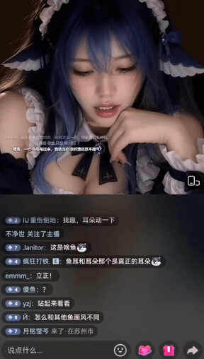
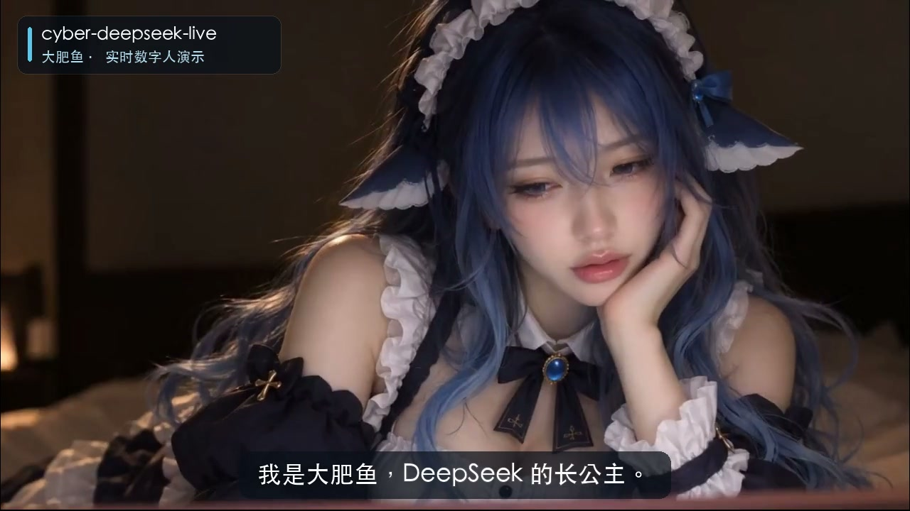
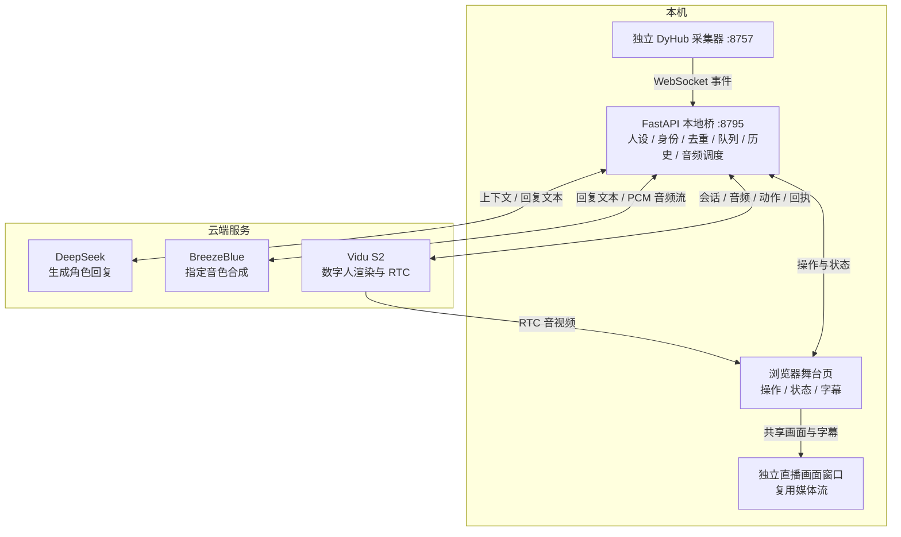

# DeepSeek Live

基于 [赛博小雅 cyber-xiaoya-live](https://github.com/cyber-xiaoya/cyber-xiaoya-live) 二次开发的数字人直播控制台。让数字人读懂弹幕、用自己的音色接话，再通过实时画面与观众互动。

当前部署采用 **本地编排 + DeepSeek 对话 + BreezeBlue 语音 + Vidu S2 数字人画面**。示例角色是蓝发鲸鱼娘「大肥鱼」：嘴硬、机灵，偶尔摆公主架子，也会认真回应观众。

> 本仓库是 Adeshen 的独立修改版本，与 DeepSeek 官方及上游官方发行无隶属关系。原项目作者为 **天工开帧 / AI少女宇宙计划组**；源码许可证与素材说明见 [LICENSE](LICENSE)、[NOTICE](NOTICE)。

## 演示

### 真实直播互动 · 约 16 秒

<p align="center">
  <a href="assets/live-demo-16s.mp4"></a>
</p>

[观看带原声的直播精选](assets/live-demo-16s.mp4) · 544 × 960 · 保留直播现场画面与声音。GIF 为其中一段静音预览。

三段接话依次是回应观众的「？」、接住观众对 AI 的夸奖，以及解释自己的「公主画风」。这是直播片段剪辑，不是端到端延迟测试。

### 角色自我介绍 · 15 秒

[](assets/demo-15s.mp4)

[观看带声音与中文字幕的自我介绍](assets/demo-15s.mp4) · 1280 × 720。画面与声音来自实际数字人会话，本段使用预先写好的介绍词。

> 演示中的形象、音色与人设用于展示效果。仓库不提供这些账号资产的使用权限，也不包含 API Key；部署时请准备自己可使用的形象与音色。

## 目前可以做什么

- **数字人实时接话**：手动聊天、直读文字，或订阅外部采集器的直播弹幕。
- **自定义角色与音色**：在 `llm.system_prompt` 中设置人设，使用 BreezeBlue 已保存的 `voice_id`，支持切换本地音色预设。
- **更像 VTuber 的互动调度**：按观众、房间、消息 ID 和时间识别弹幕；过滤重复与过期消息，每轮明确回应一个目标，减少串弹幕和重复接话。
- **语音流式发送**：聊天与弹幕回复先生成简短完整回答，再增量接收 BreezeBlue PCM 音频并送入 Vidu。
- **礼物与房间事件**：归一聊天、礼物、关注与房间状态事件，提供合并感谢与状态反馈。
- **动作控制**：手动动作、动作库、弹幕指令匹配与确认队列；是否自动执行由配置控制。
- **直播画面窗口**：独立输出数字人画面、字幕及歌词，便于 OBS 或直播伴侣采集；复用已有媒体流。
- **辅助能力**：点歌、歌词、录播与诊断接口。点歌需要自备音频，录播取决于 RTC 与会话配置。

## 架构与分工



1. **DyHub** 在独立进程中采集直播事件；本仓库通过 WebSocket 订阅。
2. **本地桥** 选择本轮回应对象、检查消息新鲜度，携带角色设定与历史请求 DeepSeek。
3. **DeepSeek** 返回简短完整回答；本地桥再调用 BreezeBlue，并把收到的 24 kHz 单声道 PCM16 音频按实时节奏发给 Vidu。
4. **Vidu S2** 生成口型、表情和动作，浏览器通过 RTC 接收声音与画面。

动作识别与语音回复分别调度。界面中的「已下发」表示指令已经发送，不能据此判断画面中的动作已经完成；同样，「语音发送结束」不等于远端已经播放结束。

当前实现是 **TTS 音频流式传输**，尚未实现 LLM 文字逐 token 输入 TTS。音色预览、礼物感谢和部分旧路径仍使用整句合成。响应速度还受排队、API 与 Vidu 播放缓冲影响。

## 部署前准备

| 项目 | 用途 |
| --- | --- |
| macOS 或 Windows、Python 3.12 | 运行本地桥；推荐使用 `uv` 管理环境 |
| `ffmpeg`，加入 PATH | 音频解码、试听及点歌等功能 |
| 支持 RTC 的现代浏览器 | 打开舞台页，接收数字人音视频 |
| Vidu API Key 与可用形象 | 创建数字人会话；本说明使用托管 RTC |
| DeepSeek API Key | 生成对话回复 |
| BreezeBlue API Key 与可访问的 `voice_id` | 合成角色语音 |
| 独立弹幕采集器（可选） | 接收真实直播弹幕；不接入时可手动聊天 |
| OBS / 直播伴侣（可选） | 将画面与声音推送至直播平台 |

本文的云端方案不需要本机 NVIDIA 显卡、WSL 或下载 TTS 模型权重。对话、语音、数字人服务分别由对应平台计费；本地打开网页不会自动创建 Vidu 会话，点击「开始连线」后才创建。

## 快速开始

### 1. 下载与安装

```sh
git clone https://github.com/Adeshen/cyber-deepseek-live.git
cd cyber-deepseek-live
```

仓库若为私有，克隆时需要相应账号权限。

**macOS**：已安装 `uv` 后，在项目目录执行：

```sh
uv venv .venv --python 3.12
uv pip install --python .venv/bin/python -r requirements.mac.lock.txt
cp config.example.json config.json
mkdir -p assets/local/breezeblue-voices/my-voice
```

也可运行 `安装依赖-Mac.command` 安装 Python 依赖。若双击脚本提示权限不足，先执行 `chmod +x *.command`。`ffmpeg` 需要另行安装。

**Windows PowerShell**：

```powershell
uv venv .venv --python 3.12
uv pip install --python .venv\Scripts\python.exe -r requirements.windows.lock.txt
Copy-Item config.example.json config.json
New-Item -ItemType Directory -Force assets/local/breezeblue-voices/my-voice
```

已有 `config.json` 的用户请直接编辑现有文件，避免覆盖原配置。

### 2. 配置三个 API

**注意：`config.example.json` 保留了上游的 OmniVoice 默认值。使用本文方案时，必须把 `tts.engine` 改为 `breezeblue`，并填写音色目录与预设名。**

在两个文本文件中分别保存自己的 Key，只放 Key 本身，不加引号或变量名：

| 凭据 | 当前读取位置 |
| --- | --- |
| Vidu | `config.json` 的 `vidu.api_key` |
| DeepSeek | `assets/local/deepseek.key`，由 `llm.key_file` 指向 |
| BreezeBlue | `assets/local/breezeblue.key`，由 `tts.breezeblue_key_file` 指向 |

将下面字段**合并到** `config.json` 的对应段，保留其余配置：

```json
{
  "vidu": {
    "api_key": "YOUR_VIDU_API_KEY"
  },
  "avatar": {
    "avatar_id": "YOUR_AVATAR_ID",
    "name": "我的数字人"
  },
  "rtc": {
    "mode": "managed"
  },
  "llm": {
    "base_url": "https://api.deepseek.com",
    "model": "deepseek-flash",
    "thinking": "disabled",
    "key_file": "assets/local/deepseek.key",
    "system_prompt": "你是一位机灵、慵懒、有一点小骄傲的成年鲸鱼娘主播。自然回应当前观众，通常一到两句；认真问题先讲清楚。不复读弹幕，不编造自己看见的画面，也不把已下发的动作说成已完成。"
  },
  "tts": {
    "engine": "breezeblue",
    "breezeblue_base": "https://api.breeze.blue/v1",
    "breezeblue_key_file": "assets/local/breezeblue.key",
    "breezeblue_timeout_sec": 120,
    "breezeblue_streaming": true,
    "voices_dir": "assets/local/breezeblue-voices",
    "voice": "my-voice"
  },
  "session": {
    "max_duration_seconds": 600
  }
}
```

这里的 `deepseek-flash` 沿用仓库配置，需确认自己的账号可调用；如平台提供其他模型，可修改 `llm.model`。首次调试可采用上例 600 秒会话上限，再按需要调整。

**环境变量说明**：DeepSeek 支持在未配置 Key 文件时读取 `DEEPSEEK_API_KEY`；当前程序不会自动加载 `.env`，也不会自动把其中的 Vidu、BreezeBlue 变量写入配置。仅放置一个三 Key 环境文件不能完成本项目配置。

### 3. 添加 BreezeBlue 音色

先在自己的 BreezeBlue 账户准备一个可调用的音色。新建 `assets/local/breezeblue-voices/my-voice/breezeblue.json`：

```json
{
  "label": "我的主播音色",
  "voice_id": "voc_YOUR_VOICE_ID",
  "params": {
    "model_id": "breeze-tts-2",
    "language_code": "zh"
  }
}
```

`tts.voice` 填文件夹名 **`my-voice`**，不是 `voc_...`。预设文件只允许 `label`、`voice_id`、`params` 三个顶层字段；Key 放在独立 Key 文件中。增加音色时，在同一父目录下再建一个预设文件夹。

`config.json`、`.env`、`*.key` 与 `assets/local/` 已被 Git 忽略。macOS 可进一步执行 `chmod 600 config.json assets/local/*.key`，并避免将含密钥的配置或备份用于分享。

### 4. 启动与验证

macOS：

```sh
.venv/bin/python -m src.main
```

也可双击 `启动-大肥鱼.command` 使用本机启动器。

Windows：

```powershell
.venv\Scripts\python.exe -m src.main
```

也可使用 `start.cmd`，通过 `status.cmd` 查看状态、`stop.cmd` 停止本地服务。Mac 启动器 `tools/run_local.py` 不适用于 Windows。

打开 **<http://127.0.0.1:8795/stage>**，检查形象与音色，点击「开始连线」，再输入一句简短问候。结束时先点网页「断开」，再停止本地服务；关闭浏览器页面不能代替结束云端会话。

## 接入直播弹幕

本仓库不包含 DyHub 采集服务。请先让独立采集器在本机 `8757` 运行，并确认目标房间正在有效采集，再修改 `config.json`：

```json
{
  "danmaku_source": {
    "enabled": true,
    "url": "ws://127.0.0.1:8757/ws?roomId=YOUR_ROOM_ID&types=chat,gift,follow,roomStatus",
    "room_id": "YOUR_ROOM_ID",
    "platform": "抖音",
    "max_age_ms": 20000
  }
}
```

通过舞台设置保存，或手工编辑后调用配置重载，弹幕源会重新订阅，无须重建数字人会话。`__hello`、`__connecting` 等控制帧不进入对话；WebSocket 连上也不代表房间正在直播，应同时查看房间状态与实际收取计数。

数字人未连线时只接收、计数，不积压消息或自动触发对话与语音。只做手动互动时，将 `danmaku_source.enabled` 设为 `false` 即可。

上游另有 [赛博小雅弹幕采集器](https://github.com/cyber-xiaoya/cyber-xiaoya-danmaku)；本说明使用的是当前部署中的 DyHub WebSocket 协议，其他采集器需按各自接口适配。

## 输出到 OBS / 直播伴侣

在舞台页点击「直播画面窗口」，使用窗口采集获取数字人画面。独立窗口复用当前会话的媒体流，不会额外开一个 Vidu 会话。

**声音从主控制台播放，独立输出窗口的视频为静音。** 请保持主控制台开启，为 OBS / 直播伴侣选择能捕获主控制台声音的音频来源，并检查监听与回声。

## 诊断与常见问题

| 现象 | 检查方向 |
| --- | --- |
| 有页面，没有数字人画面 | 是否已开始连线；形象是否就绪；Vidu 账户权限、余额与 RTC 网络 |
| 画面有了，没有声音 | `tts.engine`、Key 文件、音色预设目录、`voice_id` 权限，以及浏览器静音状态 |
| 音色列表为空 | `voices_dir` 是否指向父目录；每个子目录是否有合法 `breezeblue.json` |
| 弹幕源显示已连接，但主播不回 | 房间是否正在采集、是否有实际事件、数字人是否连线、消息是否过期或重复 |
| 回复慢或接错对象 | 查看本轮回应对象与排队、LLM、TTS 首包记录；不要把首段音频发送耗时当作观众听到的延迟 |
| 动作显示「已下发」，画面没变化 | 检查动作库、指令与云端执行；发送回执不是视觉完成确认 |
| 独立直播窗口没有声音 | 从主控制台采集音频，见上节 |

- `GET /api/health`：本地桥、TTS 引擎与弹幕源概况。
- `GET /api/live/status`：当前回合、最近回复与发送状态。
- `GET /api/danmaku/source`：采集连接、房间与事件计数。
- `POST /api/settings/reload`：手工编辑 `config.json` 后重载配置，必要时重新订阅弹幕源。
- `POST /api/danmaku`：本地注入测试弹幕，JSON 至少包含 `text`；可附 `nick`、`event_id`、`user_id`、`room_id`、`event_ts`（毫秒时间戳）。
- 日志：`logs/bridge.log`。请勿把含账号信息的完整日志直接上传。

本地注入测试不等于真实直播采集验收。字幕、发送状态与观看端实际播放可能存在缓冲差异；当前版本不承诺固定响应延迟。

## 代码与开发

| 路径 | 内容 |
| --- | --- |
| `src/bridge.py` | FastAPI 接口、舞台与状态推送 |
| `src/engine.py` | 会话、回复、语音、动作与播放调度 |
| `src/danmaku_source.py`、`src/dm_router.py` | 采集器接入、事件归一与弹幕路由 |
| `src/llm.py` | 对话模型调用 |
| `src/tts/` | BreezeBlue、旧 Breeze 网关、OmniVoice 与音频处理 |
| `src/vidu/` | Vidu 会话与信令 |
| `stage/index.html` | 舞台前端 |
| `tests/`、`tools/` | 回归测试、启动与诊断工具 |

离线回归示例：

```sh
python -m unittest discover -s tests -q
node tools/test_stage_rtc.cjs
```

在已激活项目虚拟环境的终端执行；第二条需要 Node.js。测试通过不替代各云端账号与真实直播的联调。

`LOCAL-DEPLOY.md` 和 `打包使用说明.md` 保留原机器部署、迁移包及历史验收记录，可能包含历史设置。**从 GitHub 新部署时，请以本 README 与实际代码为准**；私有配置、音色参考和验收文件不随源码提供。

## 来源与许可

本项目源自 [cyber-xiaoya/cyber-xiaoya-live](https://github.com/cyber-xiaoya/cyber-xiaoya-live)，原作者为 **天工开帧 / AI少女宇宙计划组**。感谢上游提供舞台、本地桥、Vidu 组件接入及直播功能基础。本修改版主要围绕 Mac 部署、BreezeBlue 官方语音、VTuber 式弹幕互动、状态反馈与独立直播画面完善，修改说明更新于 **2026-11-01**。

源码沿用 **GNU AGPL v3.0**，见 [LICENSE](LICENSE)。保留上游 [NOTICE](NOTICE)；其中说明的人物素材、克隆音色、人设文案、歌单、动作库及名称标识等权利不因源码许可而自动授予。第三方服务与依赖遵循各自条款和许可证。

官方服务资料：[Vidu 数字人文档](https://platform.vidu.cn/vidu-stream/doc/s2-avatar/realtime/quick-start) · [BreezeBlue 文档](https://docs.breezeblue.ai/) · [DeepSeek API 文档](https://api-docs.deepseek.com/)。
